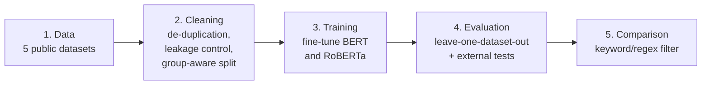
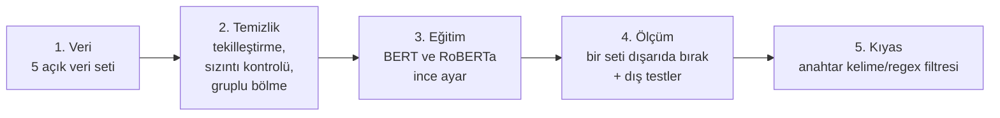

# 🛡️ prompt-injection-firewall

**Transformer-based AI firewall against prompt injection — and an honest test of how well it generalizes** 
**Prompt injection saldırılarına karşı Transformer tabanlı yapay zekâ güvenlik duvarı — ve genelleme başarısının dürüst ölçümü**

  
  
  
  

  <a href="#english"><b>English</b></a> &nbsp;|&nbsp; <a href="#türkçe"><b>Türkçe</b></a>

---

## English

Congress paper: *Detection of Prompt Injection Attacks Against Large Language Models with a Transformer-Based AI Firewall and Evaluation of Generalization Performance* — 6th International Multidisciplinary Student Congress in the Light of Science, 17–19 November 2026 (online).

<table>
  <tr>
    <td><b>Authors</b></td>
    <td>Hasan Yiğit Aydoğan, Ahmet İlter İnci</td>
  </tr>
  <tr>
    <td><b>Advisor</b></td>
    <td>Asst. Prof. Kubilay Ayturan</td>
  </tr>
  <tr>
    <td><b>Institution</b></td>
    <td>Gazi University, TUSAŞ Kazan Vocational School</td>
  </tr>
</table>

### The idea

A firewall for text. Before a prompt reaches a chat model, a classifier labels it **0 = benign** or **1 = malicious** (prompt injection / jailbreak). The question is not "how high is the accuracy on the same data?" but **"what happens on an attack style the model has never seen?"**

### How it works

1. **Data** — three public Hugging Face datasets as main data (`neuralchemy/Prompt-injection-dataset`, `xTRam1/safe-guard-prompt-injection`, `wambosec/prompt-injections`) and two as external tests (`jackhhao/jailbreak-classification`, `deepset/prompt-injections`).
2. **Cleaning and leakage control** — trimming, de-duplication, removal of texts with conflicting labels, removal of texts shared between datasets, group-aware split for `neuralchemy` (`group_id`).
3. **Models** — `bert-base-uncased` and `roberta-base`, fine-tuned for binary classification. They are downloaded automatically from Hugging Face with `from_pretrained`.
4. **Evaluation** — leave-one-dataset-out (train on two main datasets, test on the third), a same-distribution reference run, and the two external test sets. Metrics: accuracy, precision, recall, F1, ROC-AUC and true-positive rate at a low false-positive rate.
5. **Baseline** — a simple keyword/regex filter.

### Repository layout

<table>
  <tr><th align="left">File</th><th align="left">Purpose</th></tr>
  <tr><td><code>01_veri_inceleme.ipynb</code></td><td>Look at the candidate datasets (columns, labels, examples)</td></tr>
  <tr><td><code>02_isinma_egitimi.ipynb</code></td><td>Warm-up fine-tuning to check the pipeline works (not reported in the paper)</td></tr>
  <tr><td><code>03_veri_hazirlama.ipynb</code></td><td>Merge, clean, de-duplicate, leakage control, produce <code>veri_birlesik.csv</code></td></tr>
  <tr><td><code>04_anahtar_kelime_filtresi.ipynb</code></td><td>Keyword/regex baseline</td></tr>
  <tr><td><code>05_egitim_olcum.ipynb</code></td><td>Main training and evaluation: leave-one-dataset-out, reference run, external tests</td></tr>
  <tr><td><code>06_olasilik_tohumlar.ipynb</code></td><td>Seeds 43 and 44, per-example probabilities, probability–length analysis, 3-seed summary</td></tr>
  <tr><td><code>07_aile_deneyi.ipynb</code></td><td>Attack-family hold-out: train on wambosec only, remove one of 14 attack families per run</td></tr>
  <tr><td><code>results/tohum_ozet.csv</code></td><td>3-seed summary table (mean ± std)</td></tr>
  <tr><td><code>results/aile_*.csv</code></td><td>Attack-family hold-out results (BERT and RoBERTa)</td></tr>
</table>

The notebooks are written for Google Colab (a free GPU is enough). Their explanations are in Turkish.

<b>Reproducing</b>

- The datasets are **not stored in this repository**. Notebook `03` downloads the public datasets from Hugging Face and produces `veri_birlesik.csv` itself.
- Run the notebooks in order (`01` → `07`) in Colab. Notebooks `05` and `06` download `veri_birlesik.csv` from Google Drive by file ID: upload your own copy (produced by `03`) to your Drive and put its ID in place of `BURAYA_DRIVE_DOSYA_NUMARASI`.
- Notebook outputs are cleared; the aggregated results are in `results/`. Per-example predictions are not published (they contain dataset texts).
- No API keys or credentials are needed or stored here. Never commit `.env` files or tokens (they are in `.gitignore`).

### Results

Fine-tuned BERT and RoBERTa, 3 training seeds (42, 43, 44), mean ± standard deviation (n = 3, so the deviation is a rough measure). The data split is fixed (seed 42); only the training randomness changes. Raw numbers: [`results/tohum_ozet.csv`](results/tohum_ozet.csv).

| Held-out dataset | Model | Accuracy | ROC-AUC | Recall | False-alarm rate at fixed threshold (target 0.01) |
|---|---|---|---|---|---|
| safeguard | BERT | 0.561 ± 0.074 | 0.774 ± 0.064 | 0.958 | 0.495 ± 0.059 |
| safeguard | RoBERTa | 0.564 ± 0.117 | 0.798 ± 0.093 | 0.991 | 0.516 ± 0.061 |
| neuralchemy | BERT | 0.835 ± 0.092 | 0.917 ± 0.050 | 0.773 | 0.113 ± 0.032 |
| neuralchemy | RoBERTa | 0.836 ± 0.023 | 0.908 ± 0.037 | 0.762 | 0.207 ± 0.082 |
| wambosec | BERT | 0.889 ± 0.050 | 0.968 ± 0.016 | 0.912 | 0.120 ± 0.119 |
| wambosec | RoBERTa | 0.891 ± 0.031 | 0.981 ± 0.007 | 0.825 | 0.021 ± 0.010 |
| Reference (nothing held out) | BERT | 0.987 ± 0.002 | 0.999 ± 0.000 | 0.986 | 0.012 ± 0.002 |
| Reference (nothing held out) | RoBERTa | 0.987 ± 0.002 | 0.999 ± 0.000 | 0.991 | 0.012 ± 0.001 |

**Findings**

- **Same-distribution scores are misleading.** When each model is tested on the same three datasets it was trained on, accuracy is 0.987 ± 0.002 and ROC-AUC 0.999. This is not a generalization result.
- **Performance drops sharply on an unseen dataset, and varies a lot between seeds** (standard deviation 0.02–0.12). A single run would have been misleading: BERT scored 0.739 on `neuralchemy` with seed 42 and 0.921 with seed 43.
- **No clear winner between BERT and RoBERTa** in accuracy (difference at most 0.003 on the held-out sets). A tendency in favour of RoBERTa when `wambosec` is held out (higher ROC-AUC, lower false-alarm rate) was not tested with n = 3 and is not claimed as a general advantage.
- **The 1 % false-alarm target does not hold on unseen data.** With a threshold fixed on a validation split, the real false-alarm rate on held-out datasets is 2 %–52 % (and 7 %–66 % on the external test sets). Only RoBERTa on `wambosec` is close to the target.
- **`safeguard` is the hardest.** With it held out, roughly half of the benign prompts are blocked. Its harmful prompts are short single-line templates (median 95 characters), its benign prompts are long multi-line task prompts (median 186). The models' own "malicious" probability on benign `safeguard` text rises with length (Spearman 0.50 BERT, 0.55 RoBERTa; false alarms 25–29 % in the shortest quarter, 92–99 % in the longest; single seed). This is a **correlation, not proof** that length is the cause.
- **An unseen attack *type* is not the main problem.** When the models are trained on `wambosec` only and one of its 14 attack families is removed, they still detect that family well: on average 98% (BERT, min 92%) and 96% (RoBERTa, min 86%), with at most 2% false alarms (seed 42, one dataset). Together with the leave-one-dataset-out drop, this suggests the drop comes mainly from differences between datasets rather than from new attack types.
- **A simple keyword filter** (22 patterns) beats the models on `safeguard` accuracy (0.77 vs 0.56) but catches few attacks elsewhere (recall 0.08–0.29 except on `jackhhao`).

**Limitations:** 3 seeds only (no significance tests), fixed data split and threshold set, no hyperparameter search, small and partly multilingual external test sets (`deepset`); the attack-family experiment uses one dataset and one seed.

### License and data

Check the license of each dataset on its Hugging Face page before reuse.

<a href="#top">⬆ back to top</a>

---

## Türkçe

Kongre bildirisi: *Büyük Dil Modellerine Yönelik Prompt Injection Saldırılarının Transformer Tabanlı Bir Yapay Zekâ Güvenlik Duvarı ile Tespiti ve Genelleme Başarısının Değerlendirilmesi* — 6. Uluslararası Multidisipliner Öğrenci Kongresi (6th International Multidisciplinary Student Congress in the Light of Science), 17–19 Kasım 2026 (online).

<table>
  <tr>
    <td><b>Yazarlar</b></td>
    <td>Hasan Yiğit Aydoğan, Ahmet İlter İnci</td>
  </tr>
  <tr>
    <td><b>Danışman</b></td>
    <td>Dr. Öğr. Üyesi Kubilay Ayturan</td>
  </tr>
  <tr>
    <td><b>Kurum</b></td>
    <td>Gazi Üniversitesi, TUSAŞ Kazan Meslek Yüksekokulu</td>
  </tr>
</table>

### Fikir

Metin için bir güvenlik duvarı. Bir istem (prompt) sohbet modeline ulaşmadan önce bir sınıflandırıcı onu **0 = zararsız** veya **1 = zararlı** (prompt injection / jailbreak) olarak etiketler. Asıl soru "aynı veride doğruluk kaç?" değil, **"model daha önce hiç görmediği bir saldırı tarzında ne yapıyor?"**

### Nasıl çalışıyor

1. **Veri** — ana veri olarak üç açık Hugging Face veri seti (`neuralchemy/Prompt-injection-dataset`, `xTRam1/safe-guard-prompt-injection`, `wambosec/prompt-injections`), dış test olarak iki veri seti (`jackhhao/jailbreak-classification`, `deepset/prompt-injections`).
2. **Temizlik ve sızıntı kontrolü** — boşluk kırpma, tekilleştirme, çelişkili etiketlerin atılması, veri setleri arasında ortak metinlerin atılması, `neuralchemy` için grup bazlı bölme (`group_id`).
3. **Modeller** — `bert-base-uncased` ve `roberta-base`, ikili sınıflandırma için ince ayar. Hugging Face'ten `from_pretrained` ile otomatik indirilir.
4. **Ölçüm** — bir veri setini dışarıda bırakma (iki ana veri setiyle eğit, üçüncüsünde test et), aynı dağılımda referans koşu ve iki dış test seti. Metrikler: doğruluk, kesinlik, duyarlılık, F1, ROC-AUC ve düşük yanlış pozitif oranında doğru pozitif oranı.
5. **Kıyas** — basit anahtar kelime / regex filtresi.

### Depo yapısı

<table>
  <tr><th align="left">Dosya</th><th align="left">Amaç</th></tr>
  <tr><td><code>01_veri_inceleme.ipynb</code></td><td>Aday veri setlerine bakış (sütunlar, etiketler, örnekler)</td></tr>
  <tr><td><code>02_isinma_egitimi.ipynb</code></td><td>Hattın çalıştığını görmek için ısınma eğitimi (bildiride raporlanmaz)</td></tr>
  <tr><td><code>03_veri_hazirlama.ipynb</code></td><td>Birleştirme, temizlik, tekilleştirme, sızıntı kontrolü, <code>veri_birlesik.csv</code> üretimi</td></tr>
  <tr><td><code>04_anahtar_kelime_filtresi.ipynb</code></td><td>Anahtar kelime / regex kıyas filtresi</td></tr>
  <tr><td><code>05_egitim_olcum.ipynb</code></td><td>Ana eğitim ve ölçüm: bir seti dışarıda bırakma, referans koşu, dış testler</td></tr>
  <tr><td><code>06_olasilik_tohumlar.ipynb</code></td><td>Tohum 43 ve 44, örnek başına olasılıklar, olasılık–uzunluk analizi, 3 tohumluk özet</td></tr>
  <tr><td><code>07_aile_deneyi.ipynb</code></td><td>Saldırı ailesi deneyi: yalnızca wambosec ile eğit, her koşuda 14 saldırı ailesinden birini çıkar</td></tr>
  <tr><td><code>results/tohum_ozet.csv</code></td><td>3 tohumluk özet tablo (ortalama ± std)</td></tr>
  <tr><td><code>results/aile_*.csv</code></td><td>Saldırı ailesi deneyinin sonuçları (BERT ve RoBERTa)</td></tr>
</table>

Defterler Google Colab için yazıldı (ücretsiz GPU yeterli). Açıklamalar Türkçedir.

<b>Yeniden üretme</b>

- Veri setleri bu depoda **tutulmaz**. `03` defteri açık veri setlerini Hugging Face'ten indirir ve `veri_birlesik.csv` dosyasını kendisi üretir.
- Defterleri Colab'da sırayla çalıştırın (`01` → `07`). `05` ve `06` defterleri `veri_birlesik.csv` dosyasını Google Drive'dan dosya numarasıyla indirir: `03` ile ürettiğiniz kendi kopyanızı Drive'ınıza yükleyip numarasını `BURAYA_DRIVE_DOSYA_NUMARASI` yerine yazın.
- Defter çıktıları temizlendi; toplu sonuçlar `results/` içinde. Örnek başına tahminler yayımlanmıyor (veri seti metinlerini içerir).
- Burada hiçbir API anahtarı veya kimlik bilgisi kullanılmaz ya da saklanmaz. `.env` dosyalarını ve token'ları asla commit etmeyin (`.gitignore` içindedir).

### Sonuçlar

İnce ayar yapılmış BERT ve RoBERTa, 3 eğitim tohumu (42, 43, 44), ortalama ± standart sapma (n = 3, yani sapma kaba bir ölçüdür). Veri bölmesi sabit (tohum 42), yalnızca eğitimin rastgeleliği değişir. Ham sayılar: [`results/tohum_ozet.csv`](results/tohum_ozet.csv).

| Dışarıda bırakılan veri seti | Model | Doğruluk | ROC-AUC | Yakalama | Sabit eşikte yanlış alarm (hedef 0,01) |
|---|---|---|---|---|---|
| safeguard | BERT | 0,561 ± 0,074 | 0,774 ± 0,064 | 0,958 | 0,495 ± 0,059 |
| safeguard | RoBERTa | 0,564 ± 0,117 | 0,798 ± 0,093 | 0,991 | 0,516 ± 0,061 |
| neuralchemy | BERT | 0,835 ± 0,092 | 0,917 ± 0,050 | 0,773 | 0,113 ± 0,032 |
| neuralchemy | RoBERTa | 0,836 ± 0,023 | 0,908 ± 0,037 | 0,762 | 0,207 ± 0,082 |
| wambosec | BERT | 0,889 ± 0,050 | 0,968 ± 0,016 | 0,912 | 0,120 ± 0,119 |
| wambosec | RoBERTa | 0,891 ± 0,031 | 0,981 ± 0,007 | 0,825 | 0,021 ± 0,010 |
| Referans (hiçbiri dışarıda değil) | BERT | 0,987 ± 0,002 | 0,999 ± 0,000 | 0,986 | 0,012 ± 0,002 |
| Referans (hiçbiri dışarıda değil) | RoBERTa | 0,987 ± 0,002 | 0,999 ± 0,000 | 0,991 | 0,012 ± 0,001 |

**Bulgular**

- **Aynı dağılımdaki skor yanıltıcıdır.** Modeller eğitildikleri üç veri setinin test bölümünde ölçüldüğünde doğruluk 0,987 ± 0,002, ROC-AUC 0,999. Bu bir genelleme sonucu değildir.
- **Görülmeyen veri setinde başarı belirgin düşer ve tohumlar arasında çok oynar** (standart sapma 0,02–0,12). Tek koşu yanıltıcı olurdu: BERT, `neuralchemy` için tohum 42'de 0,739, tohum 43'te 0,921 aldı.
- **BERT ile RoBERTa arasında doğrulukta net bir fark yok** (dışarıda bırakılan setlerde fark en fazla 0,003). `wambosec` dışarıda bırakılınca RoBERTa lehine bir eğilim (daha yüksek ROC-AUC, daha düşük yanlış alarm) var, ama n = 3 ile test edilmedi ve genel bir üstünlük olarak yazılmıyor.
- **%1 yanlış alarm hedefi görülmeyen veride tutmuyor.** Doğrulama bölmesinde sabitlenen eşikle dışarıda bırakılan veri setlerinde gerçek yanlış alarm oranı %2–%52 (dış test setlerinde %7–%66). Hedefe yakın tek sonuç `wambosec` üzerinde RoBERTa.
- **`safeguard` en zor olanı.** Dışarıda bırakılınca zararsız istemlerin yaklaşık yarısı engelleniyor. Zararlı örnekleri kısa tek satırlık şablonlar (ortanca 95 karakter), zararsız örnekleri uzun çok satırlı görev istemleri (ortanca 186). Modellerin kendi "zararlı" olasılığı, zararsız `safeguard` metninde uzunlukla artıyor (Spearman 0,50 BERT, 0,55 RoBERTa; yanlış alarm en kısa dörtte birde %25–29, en uzun dörtte birde %92–99; tek tohum). Bu bir **korelasyondur**, nedenin uzunluk olduğunun kanıtı değildir.
- **Asıl sorun görülmemiş saldırı *türü* değil.** Modeller yalnızca `wambosec` ile eğitilip 14 saldırı ailesinden biri çıkarıldığında, o aileyi yine iyi yakalıyor: ortalama %98 (BERT, en düşük %92) ve %96 (RoBERTa, en düşük %86), yanlış alarm en fazla %2 (tohum 42, tek veri seti). Veri seti dışarıda bırakıldığındaki düşüşle birlikte bu, düşüşün asıl kaynağının yeni saldırı türü değil veri setleri arasındaki farklar olduğuna işaret ediyor.
- **Basit anahtar kelime filtresi** (22 kalıp) `safeguard` doğruluğunda modelleri geçiyor (0,77 karşı 0,56) ama diğer veri setlerinde saldırıların azını yakalıyor (`jackhhao` hariç yakalama 0,08–0,29).

**Sınırlılıklar:** yalnızca 3 tohum (anlamlılık testi yok), sabit veri bölmesi ve eşik seti, hiperparametre araması yok, küçük ve kısmen çok dilli dış test setleri (`deepset`); saldırı ailesi deneyi tek veri seti ve tek tohumla yapıldı.

### Lisans ve veri

Yeniden kullanmadan önce her veri setinin lisansını Hugging Face sayfasından kontrol edin.

<a href="#top">⬆ başa dön</a>

