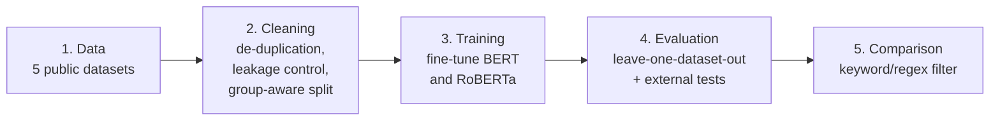
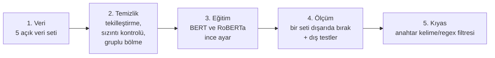

# 🛡️ prompt-injection-firewall

**Transformer-based AI firewall against prompt injection — and an honest test of how well it generalizes** 
**Prompt injection saldırılarına karşı Transformer tabanlı yapay zekâ güvenlik duvarı — ve genelleme başarısının dürüst ölçümü**

  
  
  
  

  <a href="#english"><b>English</b></a> &nbsp;|&nbsp; <a href="#türkçe"><b>Türkçe</b></a>

---

## English

Congress paper: *Detection of Prompt Injection Attacks Against Large Language Models with a Transformer-Based AI Firewall and Evaluation of Generalization Performance* — 6th International Multidisciplinary Student Congress in the Light of Science, 17–19 November 2026 (online).

<table>
  <tr>
    <td><b>Authors</b></td>
    <td>Hasan Yiğit Aydoğan, Ahmet İlter İnci</td>
  </tr>
  <tr>
    <td><b>Advisor</b></td>
    <td>Asst. Prof. Kubilay Ayturan</td>
  </tr>
  <tr>
    <td><b>Institution</b></td>
    <td>Gazi University, TUSAŞ Kazan Vocational School</td>
  </tr>
</table>

### The idea

A firewall for text. Before a prompt reaches a chat model, a classifier labels it **0 = benign** or **1 = malicious** (prompt injection / jailbreak). The question is not "how high is the accuracy on the same data?" but **"what happens on an attack style the model has never seen?"**

### How it works

1. **Data** — three public Hugging Face datasets as main data (`neuralchemy/Prompt-injection-dataset`, `xTRam1/safe-guard-prompt-injection`, `wambosec/prompt-injections`) and two as external tests (`jackhhao/jailbreak-classification`, `deepset/prompt-injections`).
2. **Cleaning and leakage control** — trimming, de-duplication, removal of texts with conflicting labels, removal of texts shared between datasets, group-aware split for `neuralchemy` (`group_id`).
3. **Models** — `bert-base-uncased` and `roberta-base`, fine-tuned for binary classification. They are downloaded automatically from Hugging Face with `from_pretrained`.
4. **Evaluation** — leave-one-dataset-out (train on two main datasets, test on the third), a same-distribution reference run, and the two external test sets. Metrics: accuracy, precision, recall, F1, ROC-AUC and true-positive rate at a low false-positive rate.
5. **Baseline** — a simple keyword/regex filter.

### Repository layout

<table>
  <tr><th align="left">File</th><th align="left">Purpose</th></tr>
  <tr><td><code>01_veri_inceleme.ipynb</code></td><td>Look at the candidate datasets (columns, labels, examples)</td></tr>
  <tr><td><code>02_isinma_egitimi.ipynb</code></td><td>Warm-up fine-tuning to check the pipeline works (not reported in the paper)</td></tr>
  <tr><td><code>03_veri_hazirlama.ipynb</code></td><td>Merge, clean, de-duplicate, leakage control, produce <code>veri_birlesik.csv</code></td></tr>
  <tr><td><code>04_anahtar_kelime_filtresi.ipynb</code></td><td>Keyword/regex baseline</td></tr>
  <tr><td><code>05_…</code>, <code>06_…</code></td><td>Main training/evaluation and multi-seed runs (added when the final runs finish)</td></tr>
</table>

The notebooks are written for Google Colab (a free GPU is enough). Their explanations are in Turkish.

<b>Reproducing</b>

- The datasets are **not stored in this repository**. Notebook `03` downloads the public datasets from Hugging Face and produces `veri_birlesik.csv` itself.
- Run the notebooks in order (`01` → `06`) in Colab.
- No API keys or credentials are needed or stored here. Never commit `.env` files or tokens (they are in `.gitignore`).

### Status

Work in progress. Final results and figures will be added here after the last runs are complete. No numbers are claimed before that.

### License and data

Check the license of each dataset on its Hugging Face page before reuse.

<a href="#top">⬆ back to top</a>

---

## Türkçe

Kongre bildirisi: *Büyük Dil Modellerine Yönelik Prompt Injection Saldırılarının Transformer Tabanlı Bir Yapay Zekâ Güvenlik Duvarı ile Tespiti ve Genelleme Başarısının Değerlendirilmesi* — 6. Uluslararası Multidisipliner Öğrenci Kongresi (6th International Multidisciplinary Student Congress in the Light of Science), 17–19 Kasım 2026 (online).

<table>
  <tr>
    <td><b>Yazarlar</b></td>
    <td>Hasan Yiğit Aydoğan, Ahmet İlter İnci</td>
  </tr>
  <tr>
    <td><b>Danışman</b></td>
    <td>Dr. Öğr. Üyesi Kubilay Ayturan</td>
  </tr>
  <tr>
    <td><b>Kurum</b></td>
    <td>Gazi Üniversitesi, TUSAŞ Kazan Meslek Yüksekokulu</td>
  </tr>
</table>

### Fikir

Metin için bir güvenlik duvarı. Bir istem (prompt) sohbet modeline ulaşmadan önce bir sınıflandırıcı onu **0 = zararsız** veya **1 = zararlı** (prompt injection / jailbreak) olarak etiketler. Asıl soru "aynı veride doğruluk kaç?" değil, **"model daha önce hiç görmediği bir saldırı tarzında ne yapıyor?"**

### Nasıl çalışıyor

1. **Veri** — ana veri olarak üç açık Hugging Face veri seti (`neuralchemy/Prompt-injection-dataset`, `xTRam1/safe-guard-prompt-injection`, `wambosec/prompt-injections`), dış test olarak iki veri seti (`jackhhao/jailbreak-classification`, `deepset/prompt-injections`).
2. **Temizlik ve sızıntı kontrolü** — boşluk kırpma, tekilleştirme, çelişkili etiketlerin atılması, veri setleri arasında ortak metinlerin atılması, `neuralchemy` için grup bazlı bölme (`group_id`).
3. **Modeller** — `bert-base-uncased` ve `roberta-base`, ikili sınıflandırma için ince ayar. Hugging Face'ten `from_pretrained` ile otomatik indirilir.
4. **Ölçüm** — bir veri setini dışarıda bırakma (iki ana veri setiyle eğit, üçüncüsünde test et), aynı dağılımda referans koşu ve iki dış test seti. Metrikler: doğruluk, kesinlik, duyarlılık, F1, ROC-AUC ve düşük yanlış pozitif oranında doğru pozitif oranı.
5. **Kıyas** — basit anahtar kelime / regex filtresi.

### Depo yapısı

<table>
  <tr><th align="left">Dosya</th><th align="left">Amaç</th></tr>
  <tr><td><code>01_veri_inceleme.ipynb</code></td><td>Aday veri setlerine bakış (sütunlar, etiketler, örnekler)</td></tr>
  <tr><td><code>02_isinma_egitimi.ipynb</code></td><td>Hattın çalıştığını görmek için ısınma eğitimi (bildiride raporlanmaz)</td></tr>
  <tr><td><code>03_veri_hazirlama.ipynb</code></td><td>Birleştirme, temizlik, tekilleştirme, sızıntı kontrolü, <code>veri_birlesik.csv</code> üretimi</td></tr>
  <tr><td><code>04_anahtar_kelime_filtresi.ipynb</code></td><td>Anahtar kelime / regex kıyas filtresi</td></tr>
  <tr><td><code>05_…</code>, <code>06_…</code></td><td>Ana eğitim/ölçüm ve çoklu tohum koşuları (son koşular bitince eklenecek)</td></tr>
</table>

Defterler Google Colab için yazıldı (ücretsiz GPU yeterli). Açıklamalar Türkçedir.

<b>Yeniden üretme</b>

- Veri setleri bu depoda **tutulmaz**. `03` defteri açık veri setlerini Hugging Face'ten indirir ve `veri_birlesik.csv` dosyasını kendisi üretir.
- Defterleri Colab'da sırayla çalıştırın (`01` → `06`).
- Burada hiçbir API anahtarı veya kimlik bilgisi kullanılmaz ya da saklanmaz. `.env` dosyalarını ve token'ları asla commit etmeyin (`.gitignore` içindedir).

### Durum

Çalışma sürüyor. Son koşular bitince kesin sonuçlar ve şekiller buraya eklenecek. O zamana kadar sayı iddia edilmiyor.

### Lisans ve veri

Yeniden kullanmadan önce her veri setinin lisansını Hugging Face sayfasından kontrol edin.

<a href="#top">⬆ başa dön</a>

